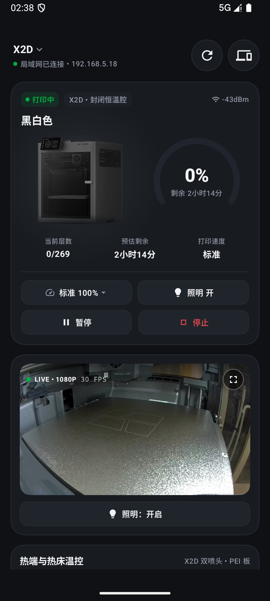
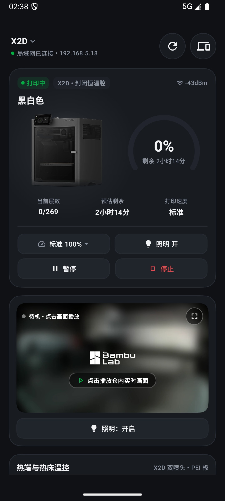
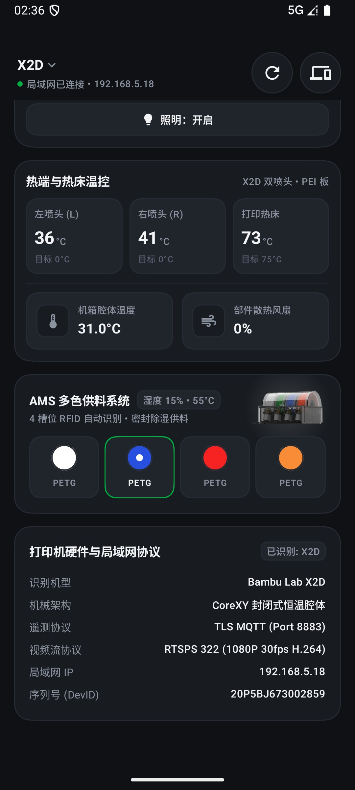
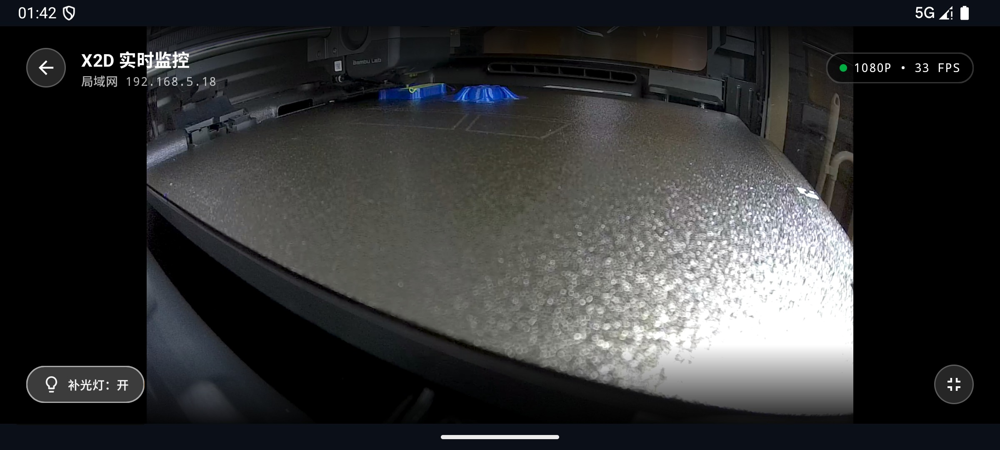
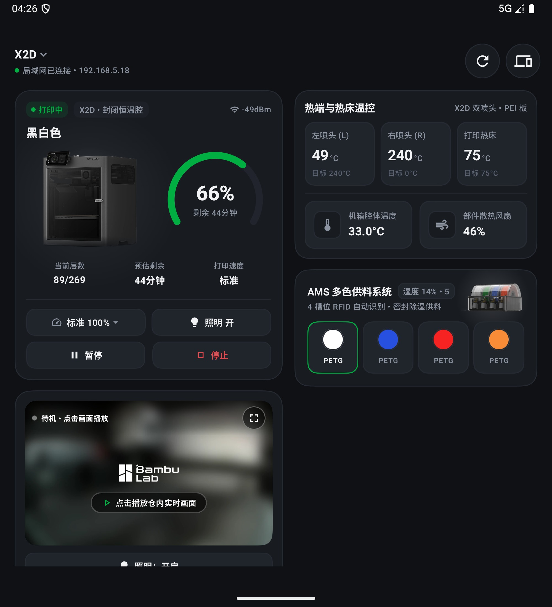
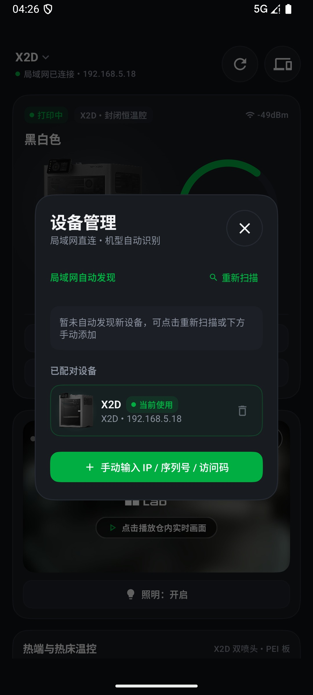
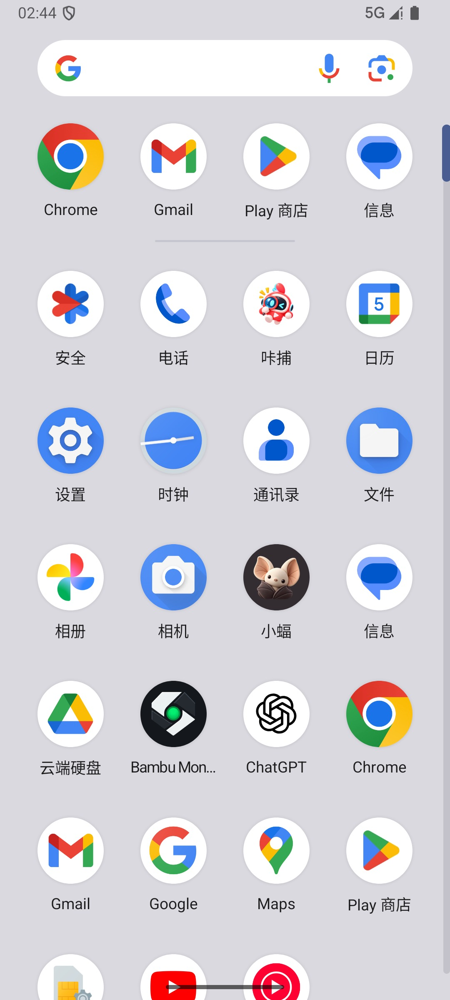

<div align="center">


# Bambu Monitor

**拓竹 3D 打印机局域网实时监控 · RTSPS 硬解视频流 · 基础温控与 AMS 状态**

[](https://github.com/Jolly-J/BambuMonitor/releases)
[](https://developer.android.com/)
[](https://kotlinlang.org/)
[](#项目结构说明方便自己改)
[](LICENSE)

</div>

---

## 为什么做这个？

原因很简单：**拓竹官方 App 的仓内监控实在太卡了。**

明明人和打印机就在同一个屋里，用官方 App 看实时画面经常毫无理由地卡顿，动不动看几秒画面就直接停住不动了。为了能痛痛快快、丝滑地看个仓内监控，我自己直接接了打印机的局域网 **RTSPS 视频流**（走手机 GPU 硬件解码，基本稳在 30 FPS），然后顺手把平时打件最常看的几个东西拓展了出来：

- **仓内实时监控**：点一下画面就能播，右上角支持一键**横屏真全屏**（保持原生 16:9 画幅，不拉伸变形）；
- **常用的随手控制**：打印速度档位切换（静音 / 标准 / 运动 / 狂暴）、腔体补光灯开关、暂停与停止；
- **温控与风扇**：左/右双喷头温度、热床温度、机箱腔体温度、部件散热风扇转速；
- **AMS 状态**：实时温湿度显示，以及 4 个槽位的耗材颜色与材质；
- **极简纯深色界面**：参考了宜家和工业仪表的性冷淡风，去掉了花里胡哨的彩虹配色，只保留深灰层级和必要的拓竹绿状态点，并适配了折叠屏展开后的双栏布局。

---

## 写在前面（使用前必看）

这不是一个大而全的成熟商业产品，只是我为了解决自己看监控卡顿折腾出来的个人小工具，目前还有很多可以打磨的地方：

1. **欢迎大家提想法共创**：除了现在面板上有的这些，后面具体还要加什么功能我还没完全想好。大家可以先下载装上用用看，觉得缺什么、哪里交互不顺手，欢迎直接在 Issue 里提出来一起聊。
2. **关于机型适配（目前仅实测 X2D）**：我手头只有一台 **X2D**（双喷头），所以目前的温度布局、风扇和视频流都是优先围着 X2D 调通的。其他机型（比如 X1、P1、A1 系列）虽然在代码里写了基础的序列号和协议枚举，但我没机器实测，具体表现不敢打包票。不过整个项目的目录分层和注释写得很规范，如果你用的是其他型号，非常欢迎直接 **Fork** 过去按自己的机器改一改，或者提个 PR 一起完善。
3. **只能局域网（外网需自己做内网穿透）**：顺嘴一说，这工具走的是纯局域网直连（`MQTT 8883` + `RTSPS 322`），不经过任何云端。如果你出门在外想用流量看，需要自己配个内网穿透（比如 Tailscale、ZeroTier、WireGuard 之类把手机和家里局域网打通），这块大家自己琢磨就行。

---

## 实际界面截图

### 手机竖屏与外屏效果

| 实时画面播放中 (1080p 硬解) | 待机与主任务控制卡片 | 双喷头温控 · 腔体风扇 · AMS |
| :---: | :---: | :---: |
|  |  |  |

### 横屏真全屏 & 折叠屏展开双栏效果

| 16:9 原画幅横屏真全屏监控 | 折叠屏展开态双栏工作台 |
| :---: | :---: |
|  |  |

| 局域网扫描与访问码配对 | 桌面图标 |
| :---: | :---: |
|  |  |

---

## 怎么用？

1. 直接去 [Releases](https://github.com/Jolly-J/BambuMonitor/releases) 下载最新的 `BambuMonitor-v1.0.0.apk` 安装到手机；
2. 在打印机屏幕上点开「设置 → 局域网模式（或网络）」，看一眼打印机的 **IP 地址**、**序列号 (DevID)** 和 **8 位访问码 (Access Code)**；
3. 打开 App 点右上角的设备图标，可以直接点局域网扫出来的机器，或者手动把 IP、序列号、访问码填进去保存，连上就能用了。

---

## 项目结构说明（方便自己改）

如果你想针对手头的其他拓竹机型自己动手改，代码结构很清晰，每个文件夹下也都放了 `AGENTS.md` 说明职责：

```text
app/src/main/java/dev/local/bambu/
├── model/                           # 数据模型：机型枚举 (PrinterModel)、遥测状态字段定义
├── data/                            # 本地存储：已配对打印机的 IP / 序列号 / 访问码持久化
├── network/                         # 核心通信层（改协议看这里）：
│   ├── BambuDiscoveryEngine.kt      # 局域网 SSDP 发现与 8883 端口扫描
│   ├── BambuMqttClient.kt           # TLS MQTT 8883 连接、状态订阅与灯光/调速/启停指令下发
│   ├── BambuTelemetryParser.kt      # 打印机增量 JSON 报文解析（适配其他机型字段主要改这里）
│   └── BambuCameraStreamClient.kt   # RTSPS 322 / TLS 6000 视频流拉取与 MediaCodec 硬件解码
└── ui/                              # 界面层（Jetpack Compose）：
    ├── DashboardScreen.kt           # 主页面（自适应单列与折叠屏双列布局）
    ├── DeviceManagementDialog.kt    # 设备扫描与手动配对弹窗
    ├── theme/                       # 纯深色配色令牌、G2 连续圆角与通用胶囊按钮
    └── components/                  # 各个独立业务卡片（任务主卡、视频卡、温控卡、AMS 卡）
```

本地编译也很简单（需要 JDK 17+ 和 Android SDK 35）：

```bash
git clone https://github.com/Jolly-J/BambuMonitor.git
cd BambuMonitor
./gradlew assembleDebug
```

---

## 开源协议

[MIT License](LICENSE)，随便折腾，欢迎提 Issue 和 PR！
